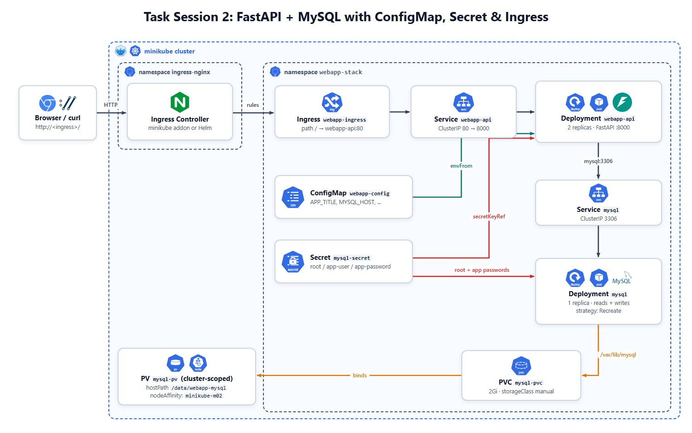

# 🚀 Task Session 2: FastAPI + MySQL with ConfigMap, Secret & Ingress

## 📝 Description

Deploy a **FastAPI** guestbook app with **one MySQL** server that reads and writes:

- 💾 MySQL keeps its data on a **PV + PVC**.
- ⚙️ The app settings are in a **ConfigMap**, and 🔐 the MySQL credentials are in a **Secret**.
- 🚦 Users reach the app through an **Ingress**.

The app (`webapp/`) and the MySQL image (`mysql/`) are provided. You build them, you don't change them.

---

## 🧩 Diagram



- Browser → Ingress Controller → Ingress `webapp-ingress` → Service `webapp-api` (80 → 8000) → 2 app Pods.
- The app connects to the Service `mysql` (port 3306). MySQL stores its data on `mysql-pvc`.

---

## 🧰 What You Need

- **Tools:** `minikube`, `kubectl`, `docker`, a machine with **8 GB RAM** is enough (tested: about 4 GB used at the peak, with 3 MySQL servers and Argo CD)
- **Cluster:** the 3-node cluster from Task 1
- **Provided files:**

| Folder | Content |
|--------|---------|
| `webapp/` | FastAPI app + `Dockerfile`. Port **8000**. Endpoints: `/`, `/health`, `/api/info`, `/api/messages` (GET, POST) |
| `mysql/` | MySQL 8.4 + `Dockerfile`. On the first start it creates the database, the app user and the table `messages` |

- **Environment variables:**

| Container | Variable | Put it in |
|-----------|----------|-----------|
| app | `APP_TITLE`, `APP_ENV`, `MYSQL_HOST`, `MYSQL_PORT`, `MYSQL_DATABASE` | ConfigMap |
| app | `MYSQL_USER`, `MYSQL_PASSWORD` | Secret |
| mysql | `MYSQL_ROOT_PASSWORD`, `APP_DB_USER`, `APP_DB_PASSWORD` | Secret |
| mysql | `APP_DB_NAME` | ConfigMap (key `MYSQL_DATABASE`) |

- **Names:**

| Resource | Name |
|----------|------|
| Namespace | `webapp-stack` |
| Images | `webapp-api:task2`, `webapp-mysql:task2` |
| Secret | `mysql-secret` (keys `root-password`, `app-user`, `app-password`) |
| ConfigMap | `webapp-config` |
| PV / PVC | `mysql-pv` / `mysql-pvc` (2Gi, storageClass `manual`) |
| MySQL Deployment + Service | `mysql` (label `app: mysql`) |
| App Deployment + Service | `webapp-api` (label `app: webapp-api`) |
| Ingress | `webapp-ingress` |

---

## 🚀 Steps

> 📌 Write one YAML file per step and apply it with `kubectl apply -f <file>.yaml`, in the order of the steps (the namespace first, the Secret and ConfigMap before the Deployments).

### 1. Build the images and load them into minikube

- Run the commands from this task's folder (the one that contains `webapp/` and `mysql/`).
- Build `webapp-api:task2` from `webapp/` and `webapp-mysql:task2` from `mysql/`, then load both into minikube.
- In the Deployments, use `imagePullPolicy: IfNotPresent`.

```bash
minikube start                 # start the Task 1 cluster if it is stopped
chmod -x mysql/initdb/01-setup.sh
docker build -t webapp-api:task2 ./webapp
docker build -t webapp-mysql:task2 ./mysql
minikube image load webapp-api:task2
minikube image load webapp-mysql:task2
minikube image ls              # check: both images are listed
```

- 💡 The warning `DEPRECATED: The legacy builder is deprecated` (Docker on Ubuntu) is harmless. Install `docker-buildx` to remove it.

### 2. Create the namespace

- Create the namespace `webapp-stack`. Every object of this task, except the PV, goes in it.

### 3. Create the Secret

- `mysql-secret` with:
  - `root-password` = `rootpass123`
  - `app-user` = `webapp`
  - `app-password` = `webapp123`
- 💡 Use `stringData` to write the values as plain text; Kubernetes stores them base64-encoded.

### 4. Create the ConfigMap

- `webapp-config` with:
  - `APP_TITLE` = `hello in MLOPS MENA COMMUNITY`
  - `APP_ENV` = `dev`
  - `MYSQL_HOST` = `mysql` (the MySQL Service name)
  - `MYSQL_PORT` = `"3306"`
  - `MYSQL_DATABASE` = `webapp`

### 5. Create the PV and PVC

- PV `mysql-pv`: 2Gi, `accessModes: [ReadWriteOnce]`, `hostPath` `/data/webapp-mysql` (`type: DirectoryOrCreate`), `storageClassName: manual`.
- PVC `mysql-pvc`: 2Gi, `accessModes: [ReadWriteOnce]`, `storageClassName: manual`, `volumeName: mysql-pv`.
- 💡 The PV has **no namespace**; the PVC is in `webapp-stack`.
- 💡 A PVC binds only to a PV with the **same** `storageClassName`. Without `manual`, minikube uses its default class `standard` and creates another volume.
- 💡 `persistentVolumeReclaimPolicy: Retain` keeps the data when the PVC is deleted.
- Pin the PV to the worker `minikube-m02` with `nodeAffinity`.
- 💡 **Why:** a `hostPath` folder exists on **one node** only. Without `nodeAffinity`, the MySQL Pod can start on another node after a restart, get a new **empty** folder there, and lose the data. With `nodeAffinity`, every Pod that uses this PV is scheduled on `minikube-m02`, where the data is.
- 💡 Skeleton (in the PV `spec`):

  ```yaml
  nodeAffinity:
    required:
      nodeSelectorTerms:
        - matchExpressions:
            - key: kubernetes.io/hostname
              operator: In
              values: [<node-name>]
  ```

```bash
kubectl get nodes -L kubernetes.io/hostname         # node names (label kubernetes.io/hostname)
kubectl get pv mysql-pv                             # check: STATUS Bound, CLAIM webapp-stack/mysql-pvc
```

### 6. Create the MySQL Deployment and Service

- Deployment `mysql`: **1 replica**, `strategy: Recreate`, image `webapp-mysql:task2`.
- Env from the Secret (`secretKeyRef`) and the ConfigMap (`configMapKeyRef`), see the table above.
- Mount `mysql-pvc` at `/var/lib/mysql`.
- Readiness probe: `mysqladmin ping -h 127.0.0.1`.
- Service `mysql`: ClusterIP, port `3306`.
- 💡 `Recreate` stops the old Pod before the new one starts: two MySQL servers must never use the same data folder.
- 💡 One env variable from one key looks like this:

  ```yaml
  env:
    - name: MYSQL_ROOT_PASSWORD
      valueFrom:
        secretKeyRef:
          name: <secret-name>
          key: <key>
  ```

- 💡 `APP_DB_NAME` uses `configMapKeyRef` the same way (name `webapp-config`, key `MYSQL_DATABASE`).
- 💡 Mount the PVC with `volumes` (`persistentVolumeClaim.claimName`) + `volumeMounts` (`mountPath`).
- 💡 Give the liveness probe a long `initialDelaySeconds` (about 60): the first start creates the database and takes time.
- ⚠️ The database and the app user are created **only on the first start** (empty folder). If you change the Secret later, MySQL keeps the old passwords and the app gets `Access denied`. Then delete the Deployment, empty the folder and start again:

  ```bash
  minikube ssh -n minikube-m02 -- sudo rm -rf /data/webapp-mysql
  ```

```bash
kubectl logs deploy/mysql -n webapp-stack          # look for "ready for connections"
kubectl get endpoints mysql -n webapp-stack        # check: 1 IP on port 3306
```

### 7. Create the app Deployment and Service

- Deployment `webapp-api`: **2 replicas**, image `webapp-api:task2`, port `8000`.
- All ConfigMap keys with `envFrom`; `MYSQL_USER` and `MYSQL_PASSWORD` from the Secret.
- Readiness and liveness probes: `GET /health` on port 8000.
- Service `webapp-api`: ClusterIP, port `80` → `8000`.
- 💡 `envFrom` passes **all** keys of a ConfigMap at once, because the keys have the same names as the app variables:

  ```yaml
  envFrom:
    - configMapRef:
        name: <configmap-name>
  ```

- 💡 `MYSQL_HOST: mysql` works because a Service name is a DNS name inside the namespace.
- ⚠️ Keep `MYSQL_PORT` in the ConfigMap. Kubernetes also adds a variable for every Service: for the Service `mysql` it sets `MYSQL_PORT=tcp://<ip>:3306`, and the app can't use that value. Your ConfigMap value replaces it.
- 💡 The Service `selector` must match the Pod label `app: webapp-api`; `targetPort` is the container port.

```bash
kubectl exec -n webapp-stack deploy/webapp-api -- env | grep -E "APP_|MYSQL_"   # check the variables
kubectl get endpoints webapp-api -n webapp-stack                              # check: 2 IPs on port 8000
```

### 8. Install the Ingress Controller

- Choose **one** option.

```bash
# Option A: minikube addon
minikube addons enable ingress

# Option B: Helm
helm upgrade --install ingress-nginx ingress-nginx \
  --repo https://kubernetes.github.io/ingress-nginx \
  --namespace ingress-nginx --create-namespace
```

```bash
kubectl get pods -n ingress-nginx            # check: controller is Running
kubectl get ingressclass                     # check: nginx
```

### 9. Create the Ingress

- `webapp-ingress`: `ingressClassName: nginx`, path `/`, `pathType: Prefix` → Service `webapp-api` port `80`.

### 10. Open the app

- Wait until every Pod is ready (MySQL needs up to 1 minute), then reach the Ingress Controller:

```bash
kubectl get pods -n webapp-stack -w                                        # Ctrl+C to stop
kubectl port-forward -n ingress-nginx svc/ingress-nginx-controller 8080:80 # keeps running: use a second terminal
```

- Open <http://localhost:8080>.
- Other ways to reach the Ingress: `http://$(minikube ip)` (Linux), or `minikube tunnel` then `http://127.0.0.1` (Windows/macOS with Docker).

---

## 🔍 Verify

| # | Check | Command | Expected result |
|---|-------|---------|-----------------|
| 1 | Images loaded | `minikube image ls` | `webapp-api:task2`, `webapp-mysql:task2` |
| 2 | Secret and ConfigMap | `kubectl get secret mysql-secret -n webapp-stack` and `kubectl get configmap webapp-config -n webapp-stack` | DATA `3` and `5` |
| 3 | PV and PVC bound | `kubectl get pv mysql-pv` and `kubectl get pvc mysql-pvc -n webapp-stack` | `Bound`, `2Gi` |
| 4 | Deployments ready | `kubectl get deploy -n webapp-stack` | `mysql 1/1`, `webapp-api 2/2` |
| 5 | MySQL on the PV node | `kubectl get pods -n webapp-stack -l app=mysql -o wide` | `1/1 Running`, NODE `minikube-m02` |
| 6 | App env | `kubectl exec -n webapp-stack deploy/webapp-api -- env` | `APP_TITLE`, `MYSQL_HOST=mysql`, `MYSQL_USER`, `MYSQL_PASSWORD` |
| 7 | Default data | `kubectl exec -n webapp-stack deploy/mysql -- sh -c 'mysql -uroot -p"$MYSQL_ROOT_PASSWORD" -e "SELECT * FROM webapp.messages"'` | 2 default messages |
| 8 | Ingress | `kubectl get ingress webapp-ingress -n webapp-stack` | CLASS `nginx`, ADDRESS filled |
| 9 | App info | `curl http://localhost:8080/api/info` | `"version": "task2"`, `"title": "hello in MLOPS MENA COMMUNITY"`, `"environment": "dev"`, `db` with the MySQL server |
| 10 | Write a message | `curl -X POST http://localhost:8080/api/messages -H "Content-Type: application/json" -d '{"author":"student","content":"hello"}'` | `{"id": 3, "written_to": "mysql-..."}` |
| 11 | Read messages | `curl http://localhost:8080/api/messages` | Your message + the 2 default ones |
| 12 | Data survives a restart | `kubectl delete pod -n webapp-stack -l app=mysql`, wait, then check 11 again | Your message is still there |

> 💡 On Windows PowerShell, use `curl.exe` instead of `curl`, and write the JSON of check 10 as `'{\"author\":\"student\",\"content\":\"hello\"}'`.

---

## 🧹 Clean Up (optional)

Keep everything for Task 3: it starts from this stack and your YAML files.

---

## 📤 Submission

To submit your task:

1. **GitHub Repository:** Create a single GitHub repository named **`Kubernetes Course Tasks`** under your GitHub account to host all course tasks.
2. **Task Folder:** Create a folder named **`Task-2`** inside this repository and place all the files and manifests you used to complete this task inside it.
3. **README with Screenshots:** Include a `README.md` file inside the `Task-2` folder documenting what was done, along with screenshots showing the commands run and the verification results.
