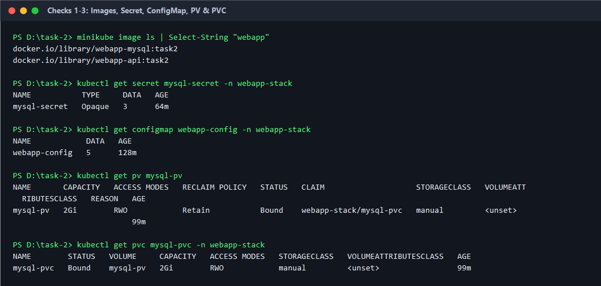
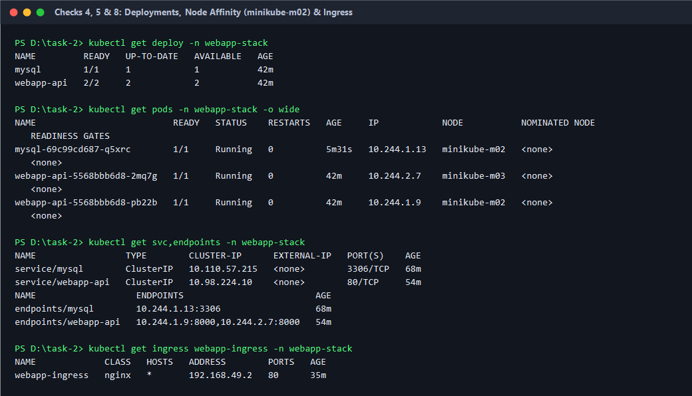
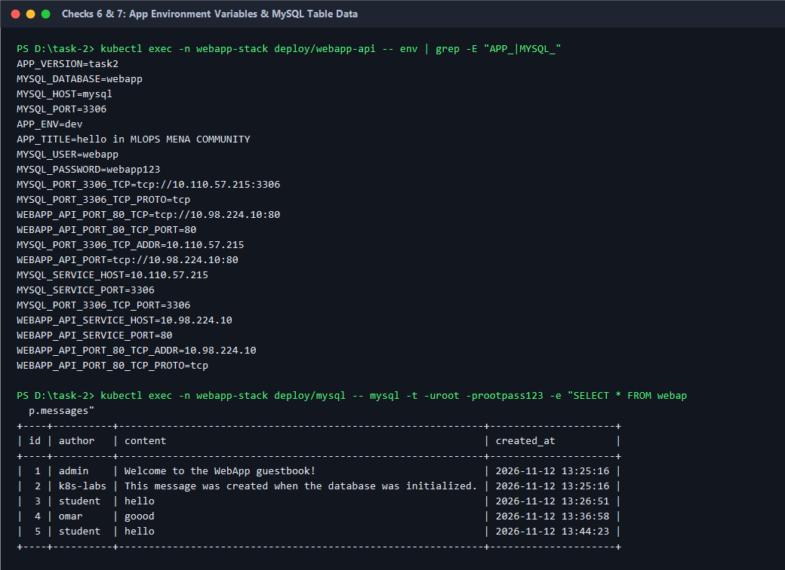
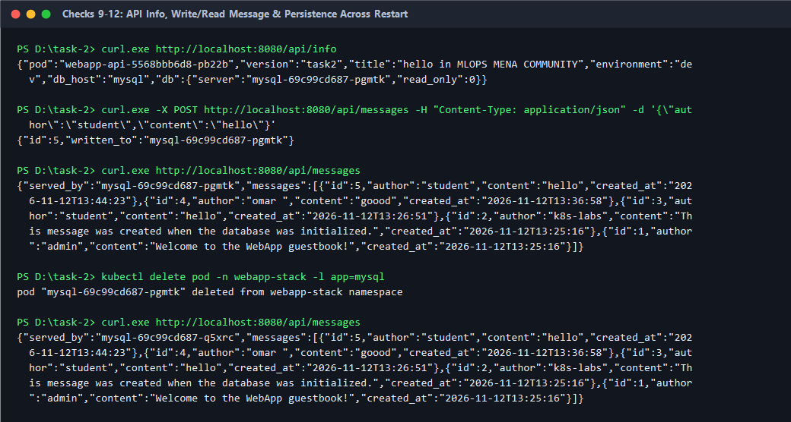
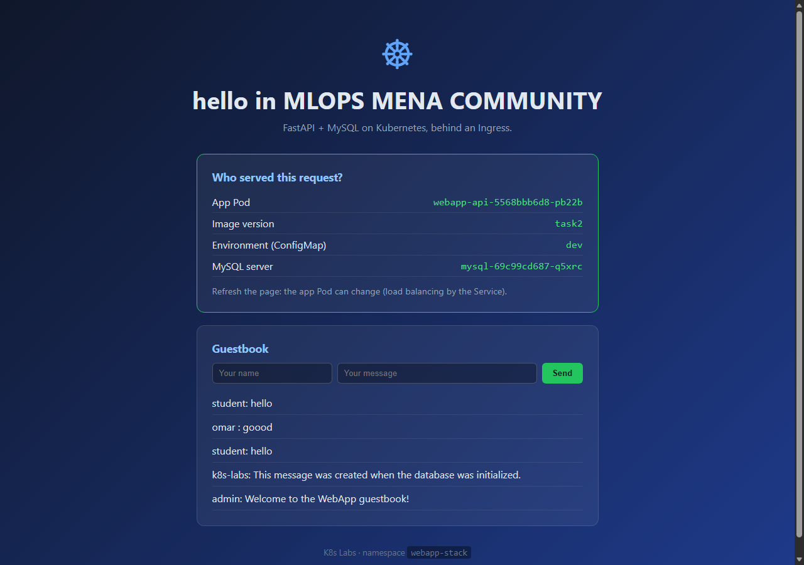

# Task 2: FastAPI + MySQL with ConfigMap, Secret, PV/PVC & Ingress

## 📋 Overview

This folder contains the Kubernetes manifests and verification results for deploying the **FastAPI** guestbook application (`webapp-api:task2`) backed by a persistent **MySQL 8.4** server (`webapp-mysql:task2`) in the `webapp-stack` namespace:

- **Namespace:** [`namespace.yml`](namespace.yml) (`webapp-stack`)
- **Secret:** [`secret.yml`](secret.yml) (`mysql-secret` storing database root and application credentials)
- **ConfigMap:** [`config-map.yml`](config-map.yml) (`webapp-config` storing app settings and MySQL connection parameters)
- **Persistent Storage:** [`mysql-pv.yml`](mysql-pv.yml) (`mysql-pv` pinned to `minikube-m02` via `nodeAffinity`) and [`mysql-pvc.yml`](mysql-pvc.yml) (`mysql-pvc` with `storageClassName: manual`)
- **MySQL Database:** [`mysql-deploymet.yml`](mysql-deploymet.yml) (`1` replica, `Recreate` strategy, readiness & liveness probes) and [`mysql-service.yml`](mysql-service.yml) (`ClusterIP` on port `3306`)
- **FastAPI WebApp:** [`webapp-deployment.yml`](webapp-deployment.yml) (`2` replicas, `envFrom` ConfigMap, Secret references, `/health` probes) and [`webapp-service.yml`](webapp-service.yml) (`ClusterIP` `80 -> 8000`)
- **Ingress:** [`ingress.yml`](ingress.yml) (`webapp-ingress` using `ingressClassName: nginx` routing `/` to `webapp-api:80`)

---

## 🚀 Commands Executed

### 1. Build & Load Images into Minikube

```bash
docker build -t webapp-api:task2 ./webapp
docker build -t webapp-mysql:task2 ./mysql
minikube image load webapp-api:task2
minikube image load webapp-mysql:task2
minikube image ls
```

### 2. Apply Kubernetes Manifests

```bash
kubectl apply -f infra/namespace.yml
kubectl apply -f infra/secret.yml
kubectl apply -f infra/config-map.yml
kubectl apply -f infra/mysql-pv.yml
kubectl apply -f infra/mysql-pvc.yml
kubectl apply -f infra/mysql-deploymet.yml
kubectl apply -f infra/mysql-service.yml
kubectl apply -f infra/webapp-deployment.yml
kubectl apply -f infra/webapp-service.yml
kubectl apply -f infra/ingress.yml
```

### 3. Enable Ingress & Port-Forward

```bash
minikube addons enable ingress
kubectl port-forward -n ingress-nginx svc/ingress-nginx-controller 8080:80
```

---

## 🔍 Verification Results & Screenshots

### 1. Images Loaded, Secret, ConfigMap, PV & PVC Bound (Checks 1–3)

- Both `webapp-api:task2` and `webapp-mysql:task2` images are loaded in Minikube.
- `mysql-secret` has `DATA: 3` and `webapp-config` has `DATA: 5`.
- `mysql-pv` and `mysql-pvc` are `Bound` (`2Gi`, `storageClassName: manual`).



---

### 2. Deployments Ready, MySQL Node Affinity & Ingress (Checks 4, 5 & 8)

- Deployments `mysql` (`1/1`) and `webapp-api` (`2/2`) are ready.
- The `mysql` Pod is scheduled on `minikube-m02` as enforced by the PV `nodeAffinity`.
- `webapp-ingress` is active with class `nginx` and assigned address `192.168.49.2`.



---

### 3. App Environment Variables & MySQL Database Messages (Checks 6 & 7)

- `webapp-api` container receives `APP_TITLE`, `APP_ENV`, `MYSQL_HOST=mysql`, `MYSQL_PORT=3306`, `MYSQL_DATABASE=webapp` from `webapp-config` and `MYSQL_USER`, `MYSQL_PASSWORD` from `mysql-secret`.
- `webapp.messages` table in MySQL contains the initialized default rows plus guestbook entries.



---

### 4. API Info, Write/Read Message & Persistence Across Restart (Checks 9–12)

- `GET /api/info` returns `"version": "task2"`, `"title": "hello in MLOPS MENA COMMUNITY"`, `"environment": "dev"`, and the connected MySQL server pod name.
- `POST /api/messages` writes a new guestbook entry and `GET /api/messages` returns all messages.
- After deleting the MySQL pod (`kubectl delete pod -n webapp-stack -l app=mysql`), the new pod starts on `minikube-m02` and retains all previously written messages.



---

### 5. Web Application UI (`http://localhost:8080`)


